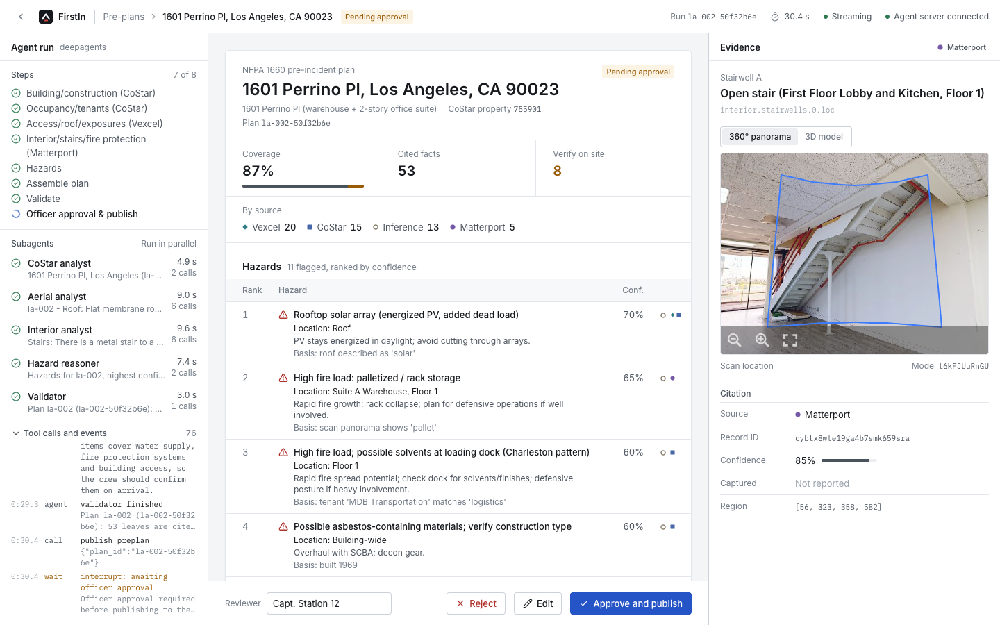
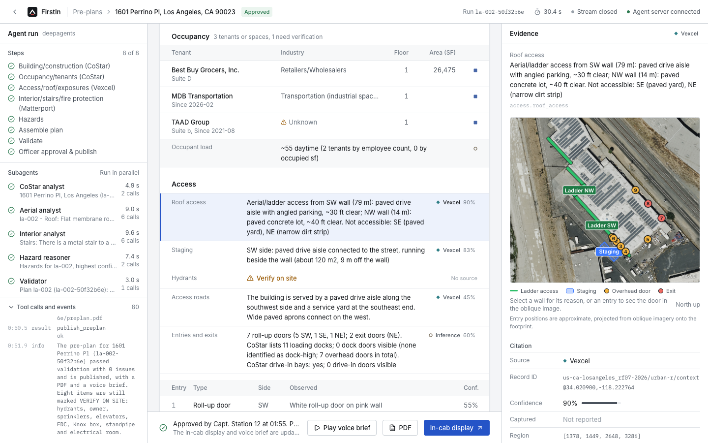
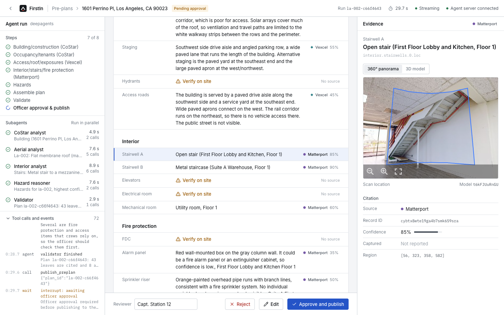
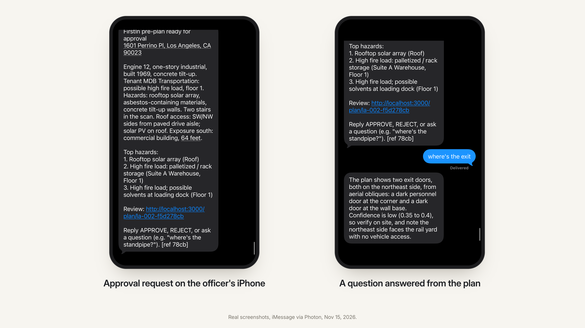
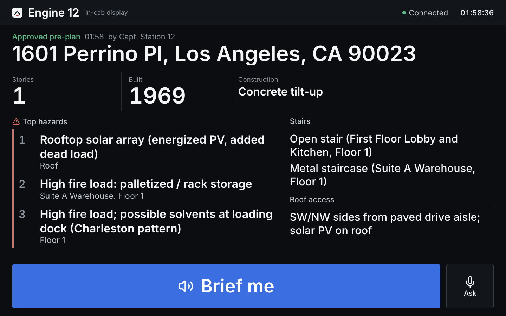
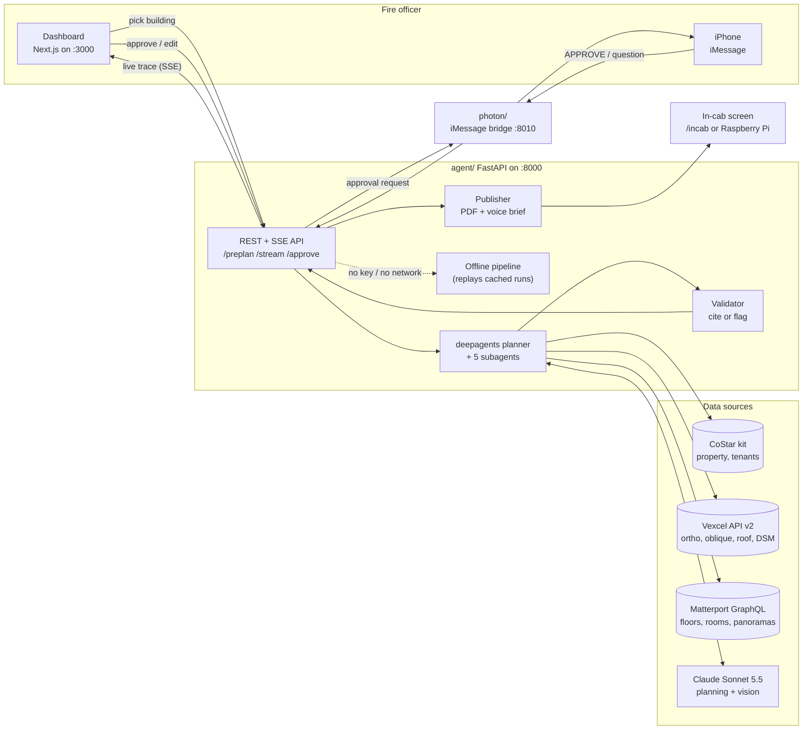
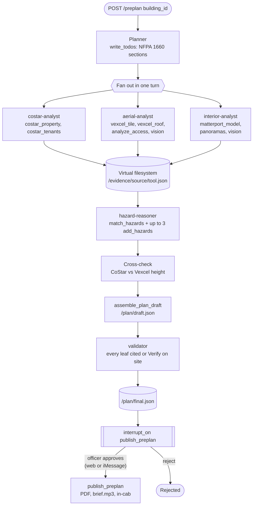
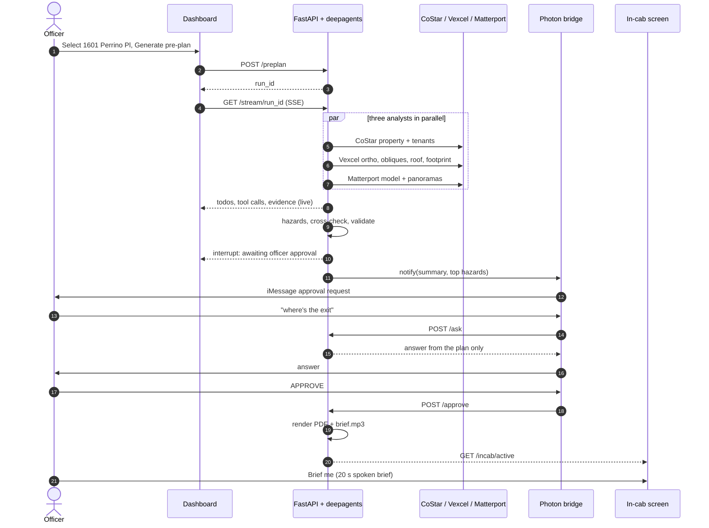

# FirstIn

**Know the building before you're inside it.**

FirstIn writes firefighter pre-incident plans automatically. An AI agent reads three data sources for the same building: CoStar property and tenant records, Vexcel aerial imagery and Matterport 3D scans. It assembles an NFPA 1660-structured plan in which every field cites its source, and anything it can't source is marked **Verify on site** instead of guessed. An officer approves the plan from the dashboard or by replying to an iMessage. The plan then goes to the engine's in-cab screen as a one-page sheet and a 20-second spoken brief.



<sub>HackPrinceton Fall 2026 · CoStar *Inside and Out: AI for the Built World* · LangChain *Best Use of Deepagents* · Photon *Messaging Agent* · Amazon *Practical AI*</sub>

---

## Contents

- [Why](#why)
- [What it does](#what-it-does)
- [Architecture](#architecture)
- [How the agent works](#how-the-agent-works)
- [One request, end to end](#one-request-end-to-end)
- [What each data source contributes](#what-each-data-source-contributes)
- [Tech stack](#tech-stack)
- [Run it](#run-it)
- [Repo layout](#repo-layout)
- [Honest limits](#honest-limits)

---

## Why

On May 31, 2013, four Houston firefighters were killed when the roof of a burning restaurant on the Southwest Freeway collapsed. The Texas State Fire Marshal's first finding was: *"There were no pre-fire plans of this structure... no indication of a record of a site diagram, fire protection systems, or construction methods."*

A pre-plan tells a crew how a building is built, where the stairs and standpipes are, what the tenants store and how to reach the roof, before they arrive. Departments make them by walking buildings, and they can't walk them all. NIOSH, 2025: *"many fire departments are unable to pre-plan for all the structures within their jurisdiction."* Plano Fire-Rescue had plans for 1,087 of 2,345 target buildings.

Pre-planning software already exists, and some of it pre-fills parcel fields from assessor records. The building itself still needs a site visit: the interior, the roof, the tenants and what they store. FirstIn fills those fields from data that already exists, with a source on every one, before anyone visits. Sources for every figure are in [demo/STORY.md](demo/STORY.md).

## What it does

| Step | What happens |
|---|---|
| 1. Pick | The officer picks any of **3,288 indexed buildings** in Houston or LA on the map. |
| 2. Plan | A deepagents planner splits the job into NFPA 1660 sections and sends **three analysts out in parallel**. |
| 3. Read | CoStar gives the building and tenants, Vexcel the roof, access and neighbors, and Matterport the inside. |
| 4. Reason | A hazard rule table plus model reasoning; each hazard lists the cited facts it came from. |
| 5. Cross-check | Facts measured by two sources are compared (10940 Wilshire: CoStar 87.8 m vs Vexcel 87.2 m). |
| 6. Validate | Every field is either cited or marked Verify on site. Nothing is guessed. |
| 7. Approve | The agent's publish call is **interrupted** until an officer approves, edits or rejects, on the web or by iMessage. |
| 8. Brief | The PDF, the voice brief and the in-cab screen with **Brief me** and spoken Q&A from the approved plan. |

Prepared buildings take about **30 seconds**; any other building takes about **50 seconds**, generated live.

<table>
<tr>
<td width="50%"><br><sub><b>Access plan.</b> Ladder walls from the Vexcel footprint, a validated staging area, and doors found in the angled aerial photos.</sub></td>
<td width="50%"><br><sub><b>Interior evidence.</b> The vision model found the stair in the Matterport 360° panorama; the box shows where.</sub></td>
</tr>
<tr>
<td width="50%"><br><sub><b>Officer approval by iMessage</b> (Photon). Real screenshots: an approval request and a question answered from the plan.</sub></td>
<td width="50%"><br><sub><b>In-cab display.</b> Top hazards, stairs and roof access. Brief me plays the spoken brief.</sub></td>
</tr>
</table>

## Architecture



The full HTTP contract and the citation format are in [CONTRACTS.md](CONTRACTS.md).

## How the agent works



Things that keep it honest:

- **Tools write evidence, not the model.** Each data tool saves its own result to the virtual filesystem, and the planner assembles the plan with code, so facts aren't retyped by the model.
- **Cite or flag.** A deterministic validator runs after the LLM validator. No field without a source gets through.
- **Accuracy checks for access.** Ladder walls come from Vexcel's measured footprint. A second vision pass checks each drawn wall, staging area and door, and drops the ones that fail.
- **No inference from age alone.** Construction type and lightweight-truss hazards need CoStar text or a scan that shows them.
- **Same flow offline.** If there's no API key or network, `pipeline.py` replays saved real runs through the same steps and emits the same events, so the demo survives bad Wi-Fi.

## One request, end to end



## What each data source contributes

| | CoStar | Vexcel | Matterport |
|---|---|---|---|
| **Building** | Year built, renovations, construction, stories, height, area, sprinklers, elevators, loading docks, electrical service | Height from the surface model, footprint | |
| **Occupancy** | Tenants, industry, floor, suite, headcount, occupant load | | Room types |
| **Roof and access** | | Roof material and condition, solar, defects, ladder walls, staging, access roads, doors from oblique photos | Entrances and lobbies |
| **Interior** | | | Stairs, mezzanines, utility rooms, storage, fire-protection equipment seen |
| **Exposures** | | Neighboring buildings with distances, combustible yards | |
| **Hazards** | From tenant industry and construction | From the roof and surroundings | From what's visible inside |

Each source finds things the other two can't, and where they overlap (height, solar), FirstIn checks them against each other.

## Tech stack

| Layer | Technology |
|---|---|
| Agent | LangChain **deepagents** 0.7, LangGraph (checkpointer + `interrupt_on`), TodoList middleware, virtual filesystem |
| Models | **Claude Sonnet 5.5** for planning and vision (Anthropic API) |
| Backend | Python 3.12, **FastAPI**, Server-Sent Events, reportlab (PDF), macOS `say` + ffmpeg (voice brief) |
| Data | CoStar hackathon kit (JSONL, lazy indexes), **Vexcel API v2** (ortho, oblique, property, DSM/DTM), **Matterport GraphQL** (models, rooms, skyboxes) |
| Frontend | **Next.js 16**, React 19, Tailwind 4, **MapLibre GL** (clustered map of 3,288 buildings), photo-sphere-viewer (360° scans), Inter |
| Messaging | **Photon v2** iMessage (HTTP API + Socket.IO), Node 24 + TypeScript |
| In-cab | `/incab` web view (Chromium kiosk); Raspberry Pi client with button, LED and speaker in `hardware/` |
| Tooling | uv, pnpm, pytest (42 tests), Playwright (screenshots and recording walkthrough) |

## Run it

**Requirements:** Python 3.12 (via uv), Node 20+, pnpm, and API keys for Anthropic, Vexcel, Matterport and, optionally, Photon.

```bash
cp .env.example .env            # fill in the keys
make venv                       # Python environment in agent/.venv
```

Sponsor data is not committed. Put the CoStar hackathon kit in `agent/data/costar/kit/`, then build the local caches:

```bash
agent/.venv/bin/python -m agent.scripts.registry_build          # building registry from the CoStar kit
agent/.venv/bin/python -m agent.scripts.registry_precache la-002 # Matterport + Vexcel caches
make warm-vision                                                 # cached vision answers
```

Start it:

```bash
make stage                                    # backend on :8000, real agent, no auto-reload
# make stage-offline                          # or: replay cached real runs, no network needed
cd web && pnpm install && pnpm dev            # dashboard on :3000
cd photon && npm install && npm start         # optional: iMessage approval on :8010
```

Open http://localhost:3000, pick a building and generate a pre-plan. The in-cab view is http://localhost:3000/incab.

| Command | What it does |
|---|---|
| `make test` | 42 backend tests: validator, hazard rules, access geometry, API flow |
| `make backend` | Development server with auto-reload |
| `make warm-vision ONLY=la-002` | Cache vision answers for one building |
| `node demo/record/walkthrough.mjs` | Paced browser walkthrough for recording the demo |

## Repo layout

| Path | What |
|---|---|
| `agent/` | FastAPI server, deepagents agent (`agent.py`), offline pipeline (`pipeline.py`), plan builder, prompts, `hazards.yaml`, tests |
| `agent/tools/` | `costar.py`, `vexcel.py`, `matterport.py`, `access.py`, `vision.py`, `hazard_rules.py`, `validator.py`, `render.py` |
| `agent/scripts/` | Registry build, Matterport and Vexcel caching, vision warm-up |
| `web/` | Next.js dashboard and `/incab`; design notes in `web/DESIGN.md` |
| `photon/` | iMessage approval and Q&A bridge |
| `hardware/` | Raspberry Pi in-cab client and an untested ESP32 SenseCAP sketch |
| `demo/` | Pitch script, story, Devpost draft, research with sources, press clippings, screenshots PDF, closing animation |
| `CONTRACTS.md` | HTTP API, SSE events, citation object, plan schema |

## Honest limits

- **Decision support, not authority.** Nothing reaches a crew without an officer's approval.
- **Partial interiors.** Matterport scans usually cover one suite, not a whole building. Automatic room labels are often wrong for commercial space, so they're treated as low confidence and checked against the panorama.
- **Approximate door positions.** Doors are found in oblique photos and projected onto the footprint, and the plan says so.
- **Tall unprepared buildings.** The aerial height can land on the wrong structure, so FirstIn cross-checks against CoStar and flags disagreement.
- **No outcome study.** No controlled study shows pre-plans reduce deaths, and we don't claim one. The case rests on fire investigations that name missing building information.

---

<sub>Sponsor data (CoStar, Vexcel, Matterport) is used under hackathon terms and is not included in this repository. News clippings in `demo/press/` are headline excerpts with attribution; sources are in `demo/press/SOURCES.md`.</sub>
